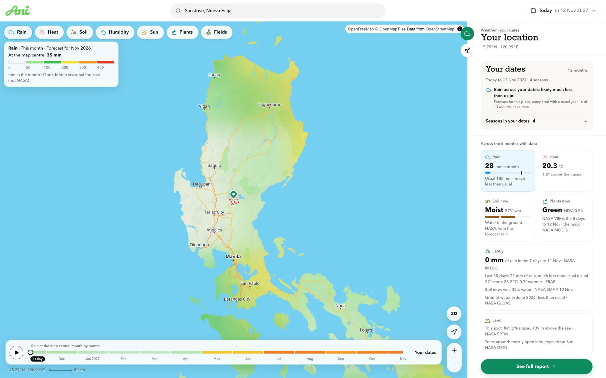
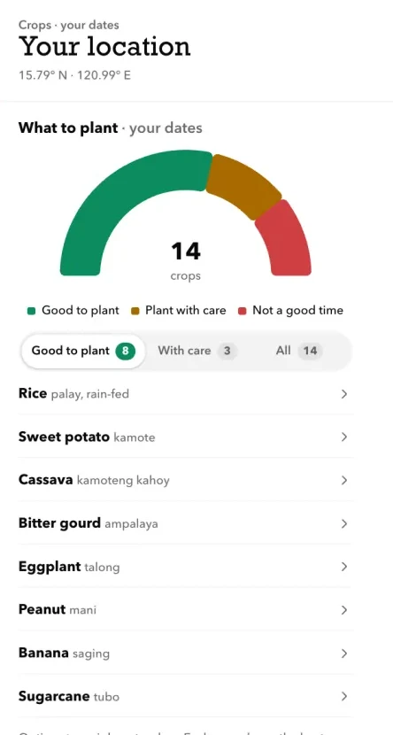
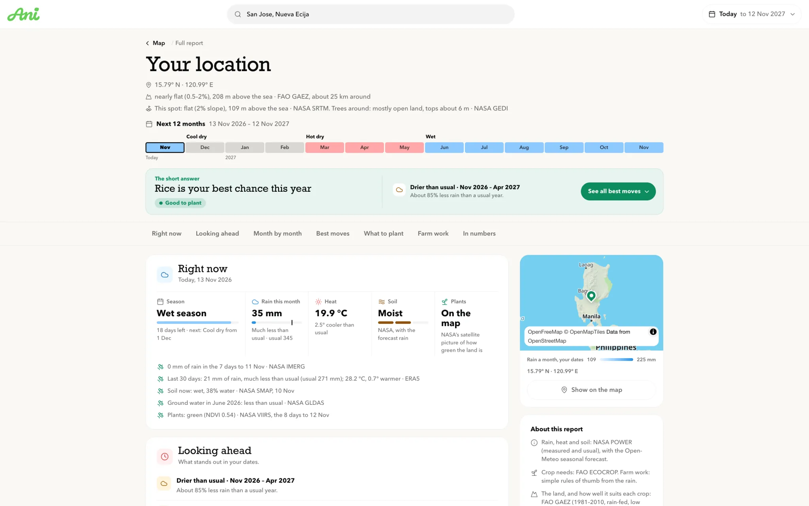

<div align="center">


# Ani

### Harvest tomorrow, planned today.

A map-based weather and planting companion for the Philippines.<br/>
Built for the **NASA Space Apps Challenge**.

[](#built-with)
[](#built-with)
[](#built-with)
[](#built-with)
[](#where-the-data-comes-from)

### [🌐 Try the live app](https://nasa-ani-app.vercel.app) · [▶️ Watch the 30-second demo](#demo)

**[Demo](#demo)** · **[Features](#features)** · **[Data](#where-the-data-comes-from)** · **[Run it](#run-it-locally)** · **[Team](#team)**

<br/>



</div>

<br/>

Pick a place and a stretch of dates. Ani shows the weather there — **what was measured, what is forecast, and what is usual** — and turns it into **which crops suit those dates and when to plant them**.

> [!NOTE]
> Ani doesn't make decisions for farmers. It shows the evidence so they can decide.

<br/>

## Demo

**Live app:** [nasa-ani-app.vercel.app](https://nasa-ani-app.vercel.app)

**30-second demo:** [▶️ Watch the video](media/ani-demo.mp4)

<br/>

## Features

### 🗺️ See the weather on a map

Rain, heat and soil since **1981**, and up to **three years ahead**. Turn on a layer and press play to watch the land change colour month by month.

| Layer | What it shows |
| :-- | :-- |
| 🌧️ **Rain** | Rain that fell or is expected, in weather-radar colours |
| 🌡️ **Heat** | The month's average temperature |
| 🟤 **Soil** | How wet the ground is |
| 💧 **Humidity** | How humid the air is, coloured by fungus risk |
| ☀️ **Sun** | How much sunlight reaches the ground |
| 🌿 **Plants** | NASA's satellite picture of how green the land is |

Every month says what kind of number it is:

| Measured | Forecast | Usual |
| :-: | :-: | :-: |
| A past month, from NASA's records | The coming ~6 months, from a seasonal forecast | NASA's long-term average for that month |

<br/>

### 🌾 Know what to plant, and when

<table>
  <tr>
    <td width="34%" valign="top">
      
    </td>
    <td valign="top">

**14 local crops**, each rated for your dates and your land:

- ✅ **Good to plant**
- ⚠️ **Plant with care**
- ❌ **Not a good time**

Each growing month's rain and heat is held up against what the crop needs, together with how well the land around the place suits it. You get the **best month to plant** and the **month it's ready**.

Open a crop for a planting calendar and a growing guide with eight short topics, from getting the land ready to the harvest.

<details>
<summary><b>See all 14 crops</b></summary>
<br/>

Rice *(palay)* · Corn *(mais)* · Mung bean *(monggo)* · Peanut *(mani)* · Sweet potato *(kamote)* · Cassava *(kamoteng kahoy)* · Tomato *(kamatis)* · Eggplant *(talong)* · Okra · Pechay · Bitter gourd *(ampalaya)* · Squash *(kalabasa)* · Banana *(saging)* · Sugarcane *(tubo)*

</details>

  </td>
  </tr>
</table>

<br/>

### 📋 Your season on one page

The full report puts everything about your place and dates together: the short answer first, then what's ahead, month by month, your best moves, what to plant and the farm work for each month.



<br/>

## How it works

| Step | |
| :-: | :-- |
| **1** | **Choose a place.** Search, or tap *Use my location* |
| **2** | **Choose dates.** Anywhere from January 1981 to three years ahead |
| **3** | **Look at the map.** Turn on a layer and play the months |
| **4** | **Open the sidebar.** *Weather* for the numbers, *Crops* for what to plant |
| **5** | **Open a crop.** When to plant it here, and how to grow it |
| **6** | **See the full report.** Everything on one page |

<br/>

## Where the data comes from

| Data | Source |
| :-- | :-- |
| Measured rain, heat, soil, humidity and sun, and the usual for each month | **NASA POWER** · monthly, since 1981 |
| Plant greenness from satellite | **NASA MODIS** · since 2002 |
| The coming months for rain, heat and soil | **Open-Meteo** seasonal forecast |
| What each crop needs | **FAO ECOCROP** |
| Slope, height and how well the land suits each crop | **FAO GAEZ** |
| Place search | **Google Places** |
| City outlines | **OpenStreetMap** |
| Map tiles | **OpenFreeMap** |
| Place names | **PSGC** |

> [!TIP]
> Ani stores nothing about you. It only asks for your location when you press *Use my location*.

<br/>

## Run it locally

**You'll need:** Node.js 22+ and a Google Maps API key with *Places API (New)* turned on.

**1. Install**

```bash
git clone https://github.com/devmaniel/nasa-space-app.git
cd nasa-space-app/client
npm install
```

**2. Add your key** in `client/.env.local`

```bash
VITE_GOOGLE_MAPS_KEY=your-google-maps-key
```

**3. Start**

```bash
npm run dev
```

<details>
<summary><b>Other scripts</b></summary>
<br/>

Run these inside `client/`.

| Command | What it does |
| :-- | :-- |
| `npm run dev` | Start the app locally |
| `npm run build` | Type-check and build for production |
| `npm run preview` | Preview the production build |
| `npm run lint` | Lint with oxlint |

</details>

<details>
<summary><b>Project layout</b></summary>
<br/>

```
client/          the web app (React + Vite)
└─ src/
   ├─ routes/    pages and URLs
   ├─ features/  home (landing page) and map (the app)
   └─ shared/    reusable UI and helpers
docs/            product notes and data sources
artifacts/       design mockups and demo slides
```

</details>

<br/>

## Built with

React 19 · TypeScript · Vite · TanStack Router · Tailwind CSS v4 · shadcn/ui · MapLibre GL · Recharts · Playwright

<br/>

## Good to know

> [!IMPORTANT]
> - Crop growing guides are **sample content**, not from an agricultural source.
> - Ratings and best moves are **options to weigh, not orders**. Local experience and experts still matter.

<br/>

## Team

<table>
  <tr>
    <td align="center" width="33%">
      <b>Khaizer Noguera</b><br/>
      <sub>Software Engineer<br/>Agritech Enthusiast</sub>
    </td>
    <td align="center" width="33%">
      <b>Mark Anthony Hernandez</b><br/>
      <sub>Senior Software Engineer<br/>Data Science Specialist</sub>
    </td>
    <td align="center" width="33%">
      <b>Melco Maniel Gulbe</b><br/>
      <sub>Software Engineer<br/>Agritech Research and Development</sub>
    </td>
  </tr>
</table>

<br/>

<div align="center">
<sub>Made for the NASA Space Apps Challenge 🌏🌾</sub>
</div>
